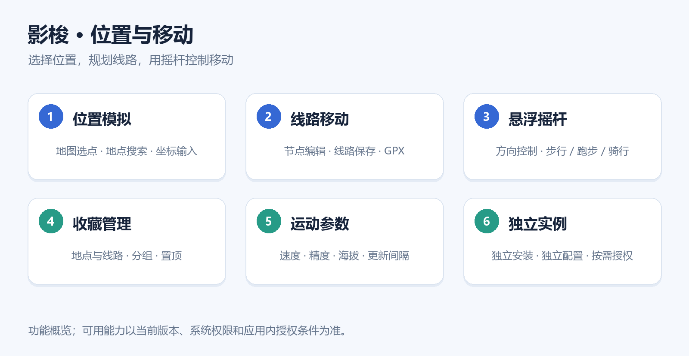
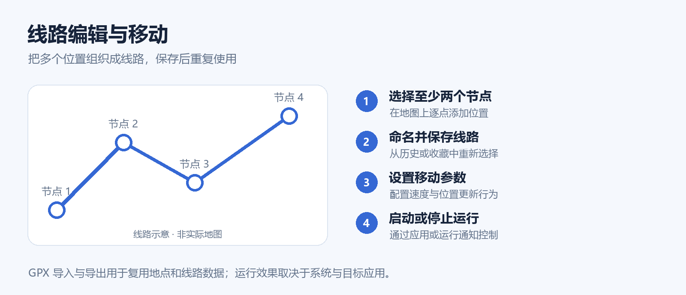
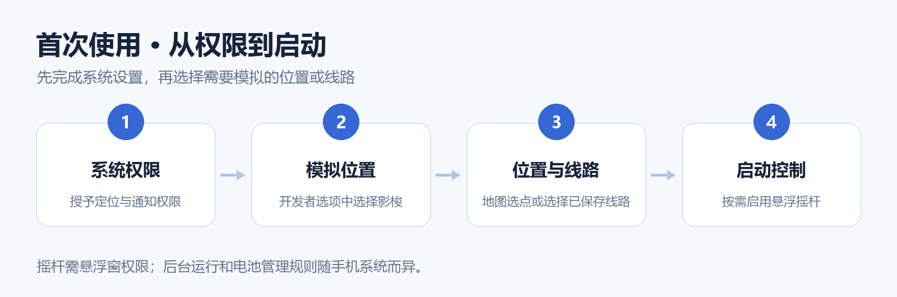

# 影梭

影梭（VirtGO）是一款 Android 位置模拟应用，支持地图选点、位置搜索、坐标输入、线路移动和悬浮摇杆，并提供位置与线路的收藏、历史记录和 GPX 导入导出。“影”寓意位置的影子，“梭”寓意在位置与线路之间穿梭。

[查看发布版本](https://github.com/ZCShou/GoGoGo/releases) · [问题反馈](https://github.com/ZCShou/GoGoGo/issues)

## 1. 功能

影梭将位置选择、线路编辑与运行控制集中在一个应用中，既能固定到一个位置，也能沿线路或通过摇杆连续移动。本页介绍当前维护版本的功能；下载历史版本时，请同时查看对应 Release 的功能与系统要求。

### 1.1 位置选择与模拟

在位置页点击地图、搜索地点，或直接输入经纬度，选择目标后启动位置模拟。地图支持普通、卫星和夜间显示，便于在不同环境下查看位置。

- 在地图上选择位置，查看坐标与地点信息。
- 通过地点搜索或坐标输入定位到目标位置。
- 保存常用地点，查看和重新选择位置历史。
- 启动、停止位置模拟，并在运行通知中查看服务状态。

### 1.2 线路编辑与移动

在线路页依次选择多个位置形成线路，保存后可从历史记录中重新选择和编辑。运行时按线路节点模拟连续移动，而不只改变一个固定坐标。

- 添加、调整和删除线路节点，查看线路距离与时长。
- 命名和保存线路，管理线路历史及收藏。
- 导入、导出 GPX 文件，复用已有地点和线路数据。
- 根据运动参数控制线路移动速度及位置更新行为。

线路从节点选择开始，经过保存和选择后再启动移动。下图说明功能流程，并非实际地图或运行轨迹截图。

### 1.3 悬浮摇杆

取得悬浮窗权限后，可以通过悬浮摇杆控制移动方向，在查看其他页面时继续调整模拟位置。摇杆支持圆形和按钮两种样式，以及不同显示尺寸。

- 切换步行、跑步、骑行速度模式，并调整各模式速度。
- 显示或隐藏摇杆，控制其样式和尺寸。
- 在系统允许的后台条件下维持位置模拟服务。

### 1.4 收藏与参数设置

常用位置和线路可通过收藏、分组及置顶进行整理。运动设置用于调整速度、海拔、方向、卫星数量、定位精度及更新间隔；参数是否被其他应用采用，仍取决于系统与目标应用的处理方式。

### 1.5 独立安装实例

影梭可在满足应用内账号与会员条件时创建自身的独立安装实例，设置独立的应用名称、包名和地图配置，用于分别管理不同的配置与数据。该功能创建的是影梭自身的分身，不是任意第三方应用的多开容器。

创建和安装过程会检查包信息、签名与授权状态。地图配置应与实例的实际包名和签名对应，具体要求以应用内提示为准。

## 2. 安装与启动

当前维护版本面向 Android 10 及以上系统，正式发布包使用 ARM64（`arm64-v8a`）架构。历史发布版本的系统要求可能不同，下载时以对应版本说明为准。

### 2.1 取得应用

从 [GitHub Releases](https://github.com/ZCShou/GoGoGo/releases) 选择需要的版本，在 Assets 中下载 APK 并安装。应用内“关于影梭”可查看当前版本和检查更新。

### 2.2 配置权限

位置模拟通过 Android 的模拟位置接口工作，通常不需要 Root。首次使用时，需要按应用提示授予定位权限，并在系统开发者选项中将影梭选为“模拟位置信息应用”；使用摇杆还需要允许悬浮窗。

完成配置后，回到影梭选择一个位置或线路并启动。模拟位置应用的设置入口、后台运行与电池管理规则会随手机系统不同而变化。

### 2.3 运行条件

后台持续运行、通知和定位权限会影响模拟服务的可用性。部分模拟及独立实例能力需要满足应用内显示的账号与会员条件；具体套餐和权限范围以当前版本界面为准。

## 3. 使用与反馈

位置模拟适合应用开发、地图与定位流程验证等场景。设置模拟位置不代表所有应用都会采纳相同结果，系统定位策略、坐标系、缓存和目标应用自身逻辑都可能影响显示。

### 3.1 定位结果检查

遇到位置偏差或未生效时，先检查模拟位置应用设置、定位权限和后台运行状态，再停止并重新启动模拟，在目标应用中刷新位置。地图显示坐标与系统位置坐标可能使用不同坐标系，不宜只比较界面上的数字判断是否出错。

### 3.2 问题反馈

通过 [GitHub Issues](https://github.com/ZCShou/GoGoGo/issues) 或应用内“帮助与反馈”提交问题时，请提供影梭版本、手机型号、Android 版本、使用的位置或线路模式、权限状态与复现步骤。分享地图、线路文件或截图前，请检查是否包含家庭地址等个人信息。
